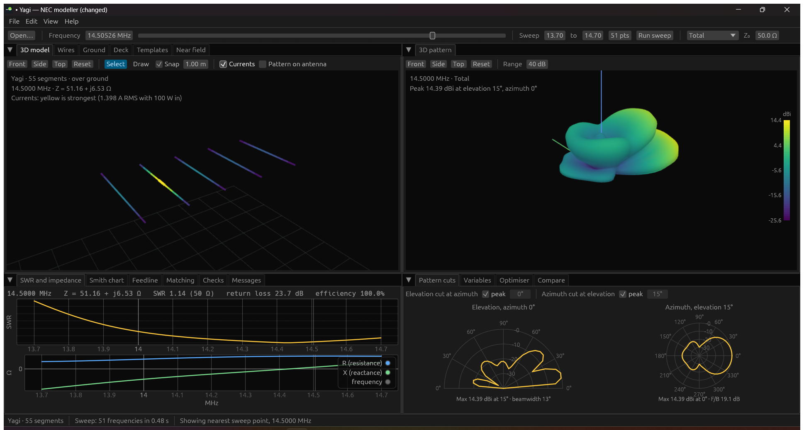
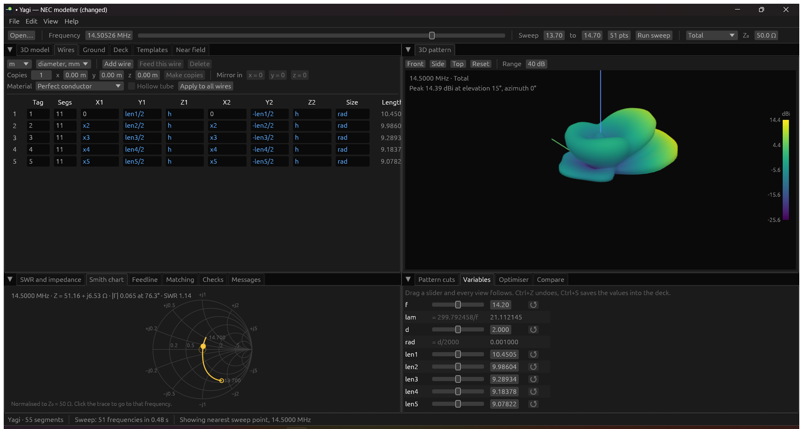
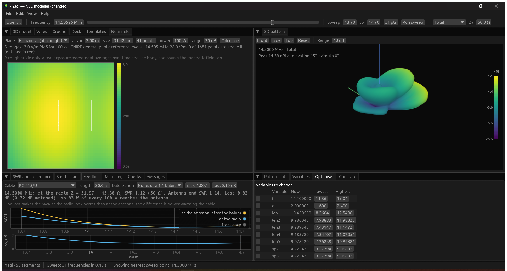

# STRAWS

A fast, modern, open-source NEC-2 antenna modeller for Windows, Linux and macOS:
draw or pick an antenna, see its pattern, SWR and currents change live as you
tune it, optimise it, match it and export the results.

See the [user guide](docs/user-guide.md) for a tour, and
[CONTRIBUTING.md](CONTRIBUTING.md) to help build it.


*A 5-element Yagi made from a template: wires coloured by current, the 3D
radiation pattern, SWR and impedance across the band, and the pattern cuts with
beamwidth and front-to-back.*


*Every dimension is a variable: the wire table shows the formulas, the Variables
view gives each a slider, and the Smith chart follows as you drag.*


*The near field at head height with an RF exposure guide, what the radio sees
through 30 m of RG-213, and the optimiser ready to tune the elements.*

## What it does
- **Everything in one window**, dark by default, with dockable views: 3D model,
  3D pattern, pattern cuts, SWR and impedance, Smith chart, feedline, feed
  system, matching, feeds, receive, checks, messages, wires, ground, deck,
  templates, near field, variables, optimiser and compare. Drag tabs to
  rearrange; the layout is kept. Light theme and a text size setting (View
  menu, or Ctrl + / Ctrl -).
- **Live frequency slider**: every view follows. A sweep with patterns runs in
  the background as soon as a model opens; where the slider stops, that exact
  frequency is recalculated in finer detail.
- **Build antennas** from 12 templates (dipole, inverted V, end-fed half-wave,
  vertical with radials, phased verticals, loop, quad, Yagi, Moxon, log-periodic,
  helix, J-pole), by drawing wires in 3D (snapping to a grid and to wire ends),
  in the wire table with exact numbers in m, cm, mm, ft, in or wavelengths, or
  as `.nec` text, or by importing a wire-frame drawing from a CAD program (DXF:
  lines, polylines, arcs, circles, ellipses and splines, layer by layer, with
  touching ends joined). Arcs (two ends and a bend, snapping to 15° steps),
  semicircles, circles, helices and spirals are drawn in 3D too. All four
  stay in step. Every template dimension is a variable
  with a live slider, and any number, length, spacing, height or angle can be
  made a variable with a right-click, no deck editing needed.
- **Generators**: radials, rings and grid counterpoises (raised as wires, or on
  or under the ground with an estimate checked against Brown, Lewis and Epstein's
  1937 measurements), flat plates, corner reflectors, dishes and curved
  reflectors of any outline and profile, and closed surface-patch boxes.
- **Ground and materials**: free space, perfect or real ground (common soil and
  water types, Sommerfeld-Norton or reflection coefficient) with the antenna's
  height; wires of any common metal, solid or hollow tubes.
- **Results**: 3D pattern coloured by gain with a readout under the mouse,
  elevation and azimuth cuts with beamwidth and front-to-back, SWR, impedance
  and return loss, Smith chart, currents and phases on the wires, near-field
  maps with an RF exposure guide, and the average gain test. RDF for receive
  antennas, and RDF and front-to-back across the sweep (Receive view).
- **Bands**: a Band menu with the ITU amateur bands of each region, or your own
  list; bands are shaded on the plots and fill in optimiser goals.
- **Optimiser**: change chosen variables within limits to meet goals (low SWR
  across one or more bands, at the feed point or at the radio through the
  feedline, gain in a direction or at the peak, front-to-back or front-to-rear,
  low common-mode current on the coax), skipping designs that can't be built. A
  global search on every core then fine-tuning, or quick fine-tuning alone; the
  best design so far shows in every view while it runs. It also fits the model
  to a measured VNA sweep: tick what could differ in the real antenna (lengths,
  height, ground, losses) and it finds the values that make the two agree.
- **Matching and feeds**: L, pi and T networks and stubs with part values (or
  the nearest standard parts), drawn on a Smith chart; feedline loss and the
  SWR the radio sees through coax or ladder line and a balun or unun; and the
  coax shield modelled as a wire, with or without a choke, to show
  common-mode current; BNC, N and SMA connectors with their loss. The Feed
  system view tunes a matching network, the cable length and the balun ratio
  over a band for the SWR at the radio, with standard part values.
- **Arrays**: the Feeds view sets every source's amplitude and phase with
  sliders (voltage or current sources, power shares, presets from end-fire to
  four-square and Dolph-Chebyshev, steering), shows each element's active
  impedance, and designs the feed: phasing lines from one junction (for a
  frequency or tuned over the sweep, with exact currents from an L network at
  each element) written into the model so NEC runs the whole network, or a 90°
  hybrid coupler.
- **Compare** designs by snapshot, overlaid on the plots, and with your own
  measurements: import a VNA sweep (Touchstone .s1p or .s2p, from a NanoVNA or
  any analyser) and see it on the SWR, impedance and Smith plots beside the
  model, with the feedline taken off if you measured through it.
- **Checks while you edit**: segments too long or too thick for the frequency,
  uneven junctions, crossing, nearly joined or duplicate wires, missing sources,
  patch sizes and closed surfaces. Problem wires turn red; edits that would
  break the model are refused with a reason. And on request: a convergence
  check (double the segments, see what moves), a tolerance check (random builds
  within your build accuracy) and a sensitivity map (which wire to trim, and
  which way).
- **Undo and redo** for every change. **Exports**: CSV (sweep, pattern,
  currents), Touchstone `.s1p`, DXF and STL (wires as tubes) for CAD, a report
  page and a build sheet (cut list, stock to buy, element positions; print to
  PDF), SVG images of the SWR plot, Smith chart and pattern cuts, and PNG
  screenshots of the window or any single view. Weight and wind load of the
  wires.
- **Opens 4nec2 decks**, including its extensions: `SY` symbols and expressions,
  unit suffixes (`61ft`, `30mm`), AWG sizes (`#12`), percentage feed positions,
  current sources (`EX 6`), MININEC ground (`GN 3`), traps (`LD 6`) and
  insulated wire (`LD 7`).
- **Fast and checked**: 24-138× faster than 4nec2's own engine on the benchmark
  set ([docs/benchmarks.md](docs/benchmarks.md)), and the results agree with it
  on 21 of 21 regression decks and 718 of 4nec2's 743 example models
  ([docs/validation.md](docs/validation.md)).

NEC-2 models wires (and simple surface patches). It does not model dielectrics or
solid structures such as patch antennas or horns.

## Running it
```
cargo run --release -p straws-gui
```
or with a deck: `cargo run --release -p straws-gui -- my_antenna.nec`. After the
first build the program is `target/release/straws` (`.exe` on Windows).

## Command-line tool
```
straws-cli run my_antenna.nec          # impedance and SWR for each frequency
straws-cli expand my_antenna.nec       # the deck with symbols evaluated
straws-cli check my_models/           # the geometry checks on decks or folders
straws-cli validate tests/decks --refs tests/references
straws-cli bench benchmarks --engine-dir C:\4nec2\exe
```
Run `straws-cli help` for everything else.

## Plans
- CAD import of solid models (STEP/STL tubes reduced to wires), and plates or
  dishes from CAD as wire grids.
- STEP export straight from the app (for now: STL, which FreeCAD turns into a
  solid and saves as STEP) and a native PDF report (for now: print the report
  page to PDF).

## Building
You need [Rust](https://rustup.rs) (stable) and a C compiler:
- Windows: Visual Studio Build Tools 2022 with the "Desktop development with C++"
  workload **and** the "C++ Clang Compiler for Windows" component (nec2c uses C99
  complex numbers, which Microsoft's own C compiler doesn't support);
- macOS: the Xcode command line tools;
- Linux: `gcc` or `clang`, plus the usual windowing libraries (see the CI file).

```
cargo build --release
cargo test --workspace
```

## Licence
GPL-3.0-or-later; see [LICENSE](LICENSE). The NEC engine is nec2c by Neoklis
Kyriazis, which is in the public domain, with fixes described in
[crates/straws-core/nec2c/README.straws.md](crates/straws-core/nec2c/README.straws.md)
(two of them found by the [xnec2c](https://github.com/KJ7LNW/xnec2c) project).

<sub>STRAWS: Skipper's Trusty Rusty Antenna Workbench System.</sub>
