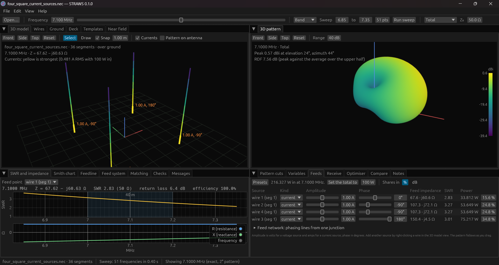
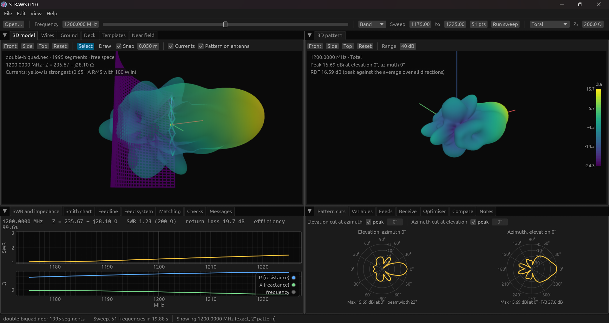
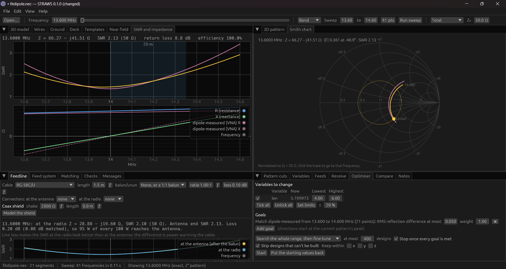

<p align="center">
  
</p>

<h1 align="center">STRAWS</h1>

<p align="center">
  A fast, modern, open-source NEC-2 antenna modeller for Windows, macOS and Linux.<br>
  Draw or pick an antenna, watch its pattern and SWR change as you tune it,
  then optimise it, match it and build it.
</p>

<p align="center">
  <a href="https://github.com/xXTheKippersXx/straws/releases">Download</a> ·
  <a href="docs/user-guide.md">User guide</a> ·
  <a href="CONTRIBUTING.md">Contributing</a>
</p>


## Download

Get the latest version from the
[Releases page](https://github.com/xXTheKippersXx/straws/releases). It's free.

| System | Download | Notes |
|---|---|---|
| Windows 10 and 11 | `…-windows-setup.exe` (installer) or `…-windows-portable.zip` | The first time, Windows may say it "protected your PC": click *More info*, then *Run anyway*. |
| macOS (Apple Silicon: M1 and later) | `…-macos-apple-silicon.dmg` | Drag STRAWS to Applications. The first time, macOS may say it can't check the developer: open System Settings > Privacy & Security and click *Open Anyway*. |
| macOS (Intel) | `…-macos-intel.dmg` | As above. |
| Linux (Debian, Ubuntu, Mint) | `…-linux-amd64.deb` | `sudo apt install ./STRAWS-…-linux-amd64.deb` |
| Linux (Fedora, openSUSE) | `…-linux-x86_64.rpm` | `sudo dnf install ./STRAWS-…-linux-x86_64.rpm` |
| Linux (any) | `…-linux.flatpak` or `…-linux-x86_64.AppImage` | Flatpak: `flatpak install STRAWS-…-linux.flatpak`. AppImage: make it executable and run it. |

The warnings on Windows and macOS appear because the downloads aren't signed
with a paid certificate; the code is all here to read and build yourself.

## What it does

**Build antennas**
- Start from one of 12 templates (dipole, inverted V, end-fed, vertical with
  radials, phased verticals, loop, quad, Yagi, Moxon, log-periodic, helix,
  J-pole), or draw wires, arcs, circles, helices and spirals in 3D with
  snapping.
- Type exact numbers in the wire table (m, cm, mm, ft, in or wavelengths), or
  edit the `.nec` text: all views stay in step.
- Make any length, spacing, height or angle a variable with a right-click and
  drag its slider.
- Add radials, ground grids, plates, corner reflectors and dishes in a click.
- Import wire-frame drawings (DXF) and solid models' tubes (STEP, STL) from
  CAD.
- Opens 4nec2 decks, including its symbols, units, current sources, traps and
  insulated wire.

**See the results, live**
- A frequency slider that every view follows: 3D pattern, pattern cuts, SWR
  and impedance, Smith chart, currents on the wires.
- Gain, front-to-back, beamwidth, RDF for receive antennas, near-field maps
  with an RF exposure guide.
- Free space, perfect or real ground (Sommerfeld-Norton or reflection
  coefficient), and wires of any common metal, solid or tube.
- Amateur band plans for each ITU region, or your own, shaded on the plots.

**Tune and feed it**
- An optimiser for SWR across bands, gain, front-to-back and common-mode
  current, using every core, with the best design so far shown as it runs.
- Fit the model to a VNA measurement (Touchstone `.s1p`/`.s2p`) to find out
  how the real antenna differs.
- Matching networks (L, pi, T, stubs) with standard part values; feedlines,
  baluns, chokes and connectors; the SWR the radio actually sees.
- Phased arrays: each element's amplitude and phase, presets from end-fire to
  four-square, and the phasing lines or hybrid that feed them.

**Trust it**
- Live checks for segments too long or short, bad junctions and crossing
  wires, with the problem wire shown in red; convergence, tolerance and
  sensitivity checks on request.
- Fast: 24 to 138 times faster than 4nec2's own engine on the
  [benchmark set](docs/benchmarks.md).
- Checked: results agree with 4nec2's engine on 718 of its 743 example models
  ([validation](docs/validation.md)).

**Keep and share it**
- `.straws` projects keep the antenna with its notes, feedline, optimiser
  set-up, snapshots and measurements; plain `.nec` decks open and save too.
- Compare designs by snapshot, undo and redo everything.
- Export a STEP solid model for CAD (each part a separate body, reflectors
  and dishes as solid sheets if you like), CSV, Touchstone, DXF and STL, SVG
  and PNG images, a report and a build sheet with the cut list.

## Screenshots


*Phased arrays: set each element's amplitude and phase with sliders and watch
the beam steer. The 3D view labels every feed.*


*Generators and 3D: a double biquad at the focus of a curved mesh reflector,
its 15.7 dBi beam drawn over the antenna.*


*Measure and fit: import a NanoVNA sweep, overlay it on the model, and let the
optimiser find what differs in the real antenna.*

**What it doesn't do:** NEC-2 models wires and simple surface patches, not
dielectrics or solid structures such as patch antennas and horns.

## Building from source

You need [Rust](https://rustup.rs) (stable) and a C compiler:
- **Windows:** Visual Studio Build Tools 2022 with "Desktop development with
  C++" **and** the "C++ Clang Compiler for Windows" component (the engine uses
  C99 complex numbers, which Microsoft's own C compiler doesn't support).
- **macOS:** the Xcode command line tools.
- **Linux:** `gcc` or `clang` and the windowing libraries listed in
  [the CI file](.github/workflows/ci.yml).

```
cargo run --release -p straws-gui
```

To open a file straight away: `cargo run --release -p straws-gui -- my_antenna.nec`.
The program ends up in `target/release/straws` (`straws.exe` on Windows).
`cargo test --workspace` runs the tests.

There is also a command-line tool, `straws-cli`, for running decks, checking
them and running the validation and benchmarks; `straws-cli help` lists what
it does.

## Licence

GPL-3.0-or-later; see [LICENSE](LICENSE). The NEC engine is nec2c by Neoklis
Kyriazis, which is in the public domain, with fixes described in
[crates/straws-core/nec2c/README.straws.md](crates/straws-core/nec2c/README.straws.md)
(two of them found by the [xnec2c](https://github.com/KJ7LNW/xnec2c) project).

<sub>STRAWS: Skipper's Trusty Rusty Antenna Workbench System.</sub>
